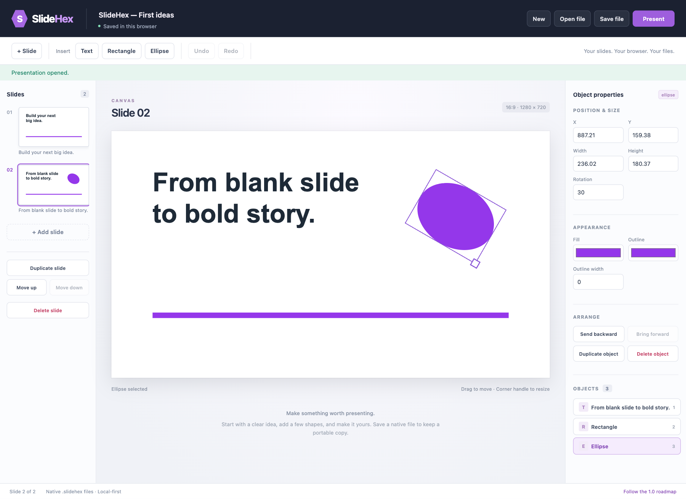

# SlideHex

An independent, local-first presentation editor for the web. Create slides in your browser and keep your files on your own machine. MIT licensed.

**Status:** the first working text-and-shape authoring increment is implemented. This is **not the completed 1.0 release** or a full PowerPoint replacement. Track the [first-release epic](https://github.com/jerryfane/slidehex/issues/1) and [1.0 milestone](https://github.com/jerryfane/slidehex/milestone/1).



## Run locally

Requires Node.js 24 or newer and npm.

```sh
npm ci
npm run dev
```

Open the localhost address printed by Vite. The server binds only to `127.0.0.1` by default. Production build and local preview:

```sh
npm test
npm run build
npm run preview
```

The production app is a static site in `dist/`; no application server, account, API key or cloud document service is required. Serving it needs a web server; opening `index.html` directly from disk is not supported.

## What works now

- Create, duplicate, reorder and delete slides; rename the presentation and change slide backgrounds.
- Add multiline plain text, rectangles and ellipses.
- Select from the canvas or object list; drag, resize, rotate through the inspector, style, duplicate, delete and change stacking order.
- Set text font, size, bold, alignment and color; set shape fill/outline.
- Undo/redo with a bounded 100-edit history. Pointer gestures produce one undo step and can be cancelled with Escape.
- Browser-local draft recovery and explicit native `.slidehex` file download/open.
- Invalid files are rejected without replacing the current deck. Corrupt drafts are preserved with autosaving paused until explicitly resumed.
- Present slides with arrow keys, Home/End and Escape. This is an in-browser presentation view, not OS fullscreen or a presenter-notes window.

Use **Open file** to load [`examples/first-ideas.slidehex`](examples/first-ideas.slidehex), an original two-slide example created through the editor.

## Editing and shortcuts

Double-click text on the canvas to focus its Content field. Numeric inspector fields commit on Enter or blur. Drag an object to move it; drag its corner handle to resize it. Use the object list to select covered objects.

| Action | Shortcut |
| --- | --- |
| Download native file | Ctrl/Cmd+S |
| Undo / redo outside text fields | Ctrl/Cmd+Z / Ctrl/Cmd+Shift+Z or Ctrl/Cmd+Y |
| Duplicate selected object outside text fields | Ctrl/Cmd+D |
| Delete selected object outside text fields | Delete / Backspace |
| Move a focused canvas object | Arrow keys; Shift for 10-unit steps |
| Resize a focused corner handle | Arrow keys; Shift for 10-unit steps |
| Cancel a drag / exit presentation | Escape |
| Presentation next / previous | Right or Down / Left or Up; PageDown/PageUp |

## Saving and privacy

**Browser-local storage is not a backup.** Use **Save file** to keep a portable copy before clearing site data, switching browser/profile, or starting a new deck. A new/imported deck replaces the one local draft after confirmation. Concurrent multi-tab editing and document libraries are not implemented yet.

Native files are JSON with a format/version header, strict runtime validation, unique IDs and explicit bounds. Current limits: 5 MiB per native file, 200 slides, 500 elements per slide and 20,000 characters per text element. Storage failure leaves the current work in memory and tells you to download a file. There are no document uploads or analytics. The roadmap link is an explicit external GitHub navigation.

## Current limitations

- Desktop browser layout; minimum editor width is 960 CSS pixels. Mobile editing is not supported.
- Fixed 1280 × 720 / 16:9 slides.
- Plain text only. Wrapping uses deterministic approximate font widths; installed fonts can affect glyph appearance. Text can overflow its element box. Rich text, text-fit and precise typography are tracked separately.
- Images, multi-selection/groups, alignment tools, system clipboard editing, themes/layouts and speaker notes are not implemented in this increment.
- No PPTX import/export or PDF export yet. Those are distinct required 1.0 issues, not hidden or nonfunctional controls.
- A native Windows PowerPoint reference environment is available for later compatibility verification; **this increment has not been compared to PowerPoint for file or pixel fidelity**.
- Naming availability is not trademark clearance. Another GitHub repository uses the same name under a different owner. SlideHex is independent and not affiliated with Microsoft or Riot Games.

## Road to 1.0

The [epic](https://github.com/jerryfane/slidehex/issues/1) is authoritative for scope, dependencies and release gates. Its linked sub-issues cover authoring, object tools, typography, images, layouts/notes, recovery, presenting/PDF, bounded PPTX export/import, quality, and release packaging. A full 1.0 is not complete until those acceptance gates have observed evidence.

See [architecture](docs/architecture.md), [verification record](docs/verification.md), and [contribution guidance](CONTRIBUTING.md).

## License

[MIT](LICENSE). Use original or properly licensed assets for examples and tests. Do not commit credentials, private presentations, VM records or proprietary product assets.
